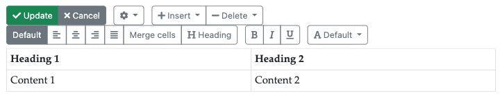

# Working with tables

Tables are often used in schedules and to show information in columns.


[marking-up-tables.md](../../../markup-guide/marking-up-tables.md)


## How to insert a table in Edit mode

1. Enter Edit mode.
2. Click **Insert** and then **Insert table**.
3. Click **Update**.

Laws.Africa will add a simple table with two rows and two columns.

## **How to copy a table from a Word document**

You can copy and paste a table from a Word document.

1. Highlight the table in the Word document.
2. Copy the table to the clipboard (with Ctrl+C or choosing **Copy** from the **Edit** menu).
3. In Laws.Africa, enter Edit mode.
4. Position the cursor at the start of the line where you would like to place the table.
5. Paste the table with Ctrl+V or by choosing **Paste** from your browser's **Edit** menu.
6. Hit Tab until it has been indented appropriately.

## How to edit a table



1. Click **Edit table** to enter table edit mode.
2. Insert or delete columns and rows using **Insert** and **Delete**.
3. Merge cells by highlighting them and clicking **Merge cells**.
4. Mark heading cells by highlighting them and clicking **Heading**.
5. Resize columns by dragging the border between them.
6. Adjust the formatting using the controls described below.
7. Click **Update** to apply your changes, or **Cancel** to discard them. Save the document when you have finished editing.

### Format the whole table

Click the **gear button** (**Table Formatting**) to open the table-wide settings. You do not need to select any cells.

* **Text size**: choose Default, Normal, Small, Extra small or Extra-extra small.
* **Alignment**: choose Default, Left, Centre, Right or Justify. Justify aligns text with both sides of the cell.
* **Remove cell padding**: remove the space between the cell contents and its edges throughout the table.
* **Remove cell borders**: hide the borders throughout the table. Dotted guides remain visible in the editor so that you can find the cells; they are not publication borders.

Uncheck either checkbox to remove that table-wide setting. Padding and borders are separate settings; padding classes on individual cells remain in place.

### Format selected cells

Click inside a cell, or drag across cells to select several. Use the **A (font) dropdown** beside Bold, Italic and Underline to change the selected cells' text size. Use the alignment buttons to choose Default, Left, Centre, Right or Justify for those cells.

Cell controls are disabled when no cells are selected. If selected cells have different size settings, the size control shows **Mixed**. Choosing a size applies it to all selected cells. Alignment buttons show the setting shared by the selection; a mixed selection has no shared alignment highlighted.

A cell's own setting takes precedence over the table's setting. For example, you can make a table Small and its heading cells Normal. Paragraphs with their own formatting inside a cell keep that formatting when the table is saved.

### Default and Normal

**Default** removes the size or alignment setting from the table or selected cells, allowing the surrounding content and publication defaults to determine the result. It does not remove other formatting. For a cell, Default usually means following the table's setting.

**Normal** explicitly selects the document's normal text size, even inside a smaller table. Similarly, **Left** explicitly selects left alignment; use Default to follow the inherited alignment instead.

The exact sizes and defaults can differ between publications. See the [formatting reference](../../../markup-guide/marking-up-formatting.md#text-size-and-alignment-classes) for the available classes, and the [Kenya Annual Supplement guide](../../../style-guides/kenya-annual-supplement.md) for its specific rules.

## **Exercise**

Copy the table below into your document:

1. Enter Edit mode.
2. Copy the text below.
3. Paste the table into your document and click **Update**.

```
    TABLE
      TR
        TC
          Vegetables

        TC
          Fruits

      TR
        TC
          Cucumber

        TC
          Apples

      TR
        TC
          Carrots

        TC
          Pears

      TR
        TC
          Lettuce

        TC
          Oranges

      TR
        TC
          Tomatoes

        TC

```

It should look something like this:

| Vegetables | Fruits  |
| ---------- | ------- |
| Cucumber   | Apples  |
| Carrots    | Pears   |
| Lettuce    | Oranges |
| Tomatoes   |         |

Now make the header cells bold.

1. Click **Edit table**.
2. Highlight the header cells individually or as a group and click **Heading**.

A tomato is [actually a fruit](https://en.wikipedia.org/wiki/Tomato#Fruit_versus_vegetable). Put it under both columns by merging the two cells in the tomato row.

1. Select the Tomatoes cell and the one next to it by dragging the mouse.
2. Click **Merge cells**.
